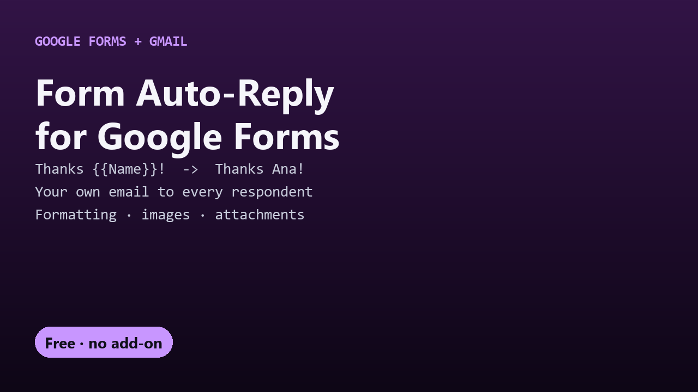

# Free Form Auto-Reply for Google Forms

Send every Google Form respondent your own personalized email, written as a Gmail draft. One free Apps Script file, no add-on.

## Guides

- [How to send a custom confirmation email from Google Forms](google-forms-custom-confirmation-email.html)
- [A free alternative to Email Notifications for Google Forms](email-notifications-for-google-forms-alternative.html)

## Get it

The script and full instructions are on GitHub: [DecodedXR/form-auto-reply](https://github.com/DecodedXR/form-auto-reply). It's MIT licensed and free.
